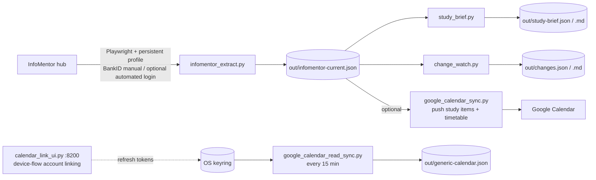

# Architecture (InfoBuddy)

InfoBuddy is self-hosted software that extracts school information from InfoMentor
and can sync it to your own Google Calendar.

- **`run_pipeline.py`** chains extraction, Study Brief, change detection and the optional
  push sync. It records the outcome in `.infomentor-state/sync_status.json`, which is
  read by the tray/menu-bar apps.
- **Generic Google Calendar read sync** is independent of InfoMentor. Accounts are linked
  with the OAuth *Device Authorization Grant*, so a headless host never needs a browser.
- **`calendar_link_ui.py`** is a small stdlib web UI for linking accounts and choosing
  calendars. It has its own login (keyring service `infobuddy-link-ui`) with a session
  cookie, CSRF tokens and a login rate limit; see `link_ui_auth.py` and `web_auth.py`.
- **Credentials** are kept in the OS keyring only. On a headless Linux host that is the
  `keyrings.cryptfile` backend, unlocked with `KEYRING_CRYPTFILE_PASSWORD` from
  `~/.config/infobuddy/keyring-secret.env`; see `keyring_linux_bootstrap.py`.
- **Data model:** see [DATA_MODEL.md](../DATA_MODEL.md). For the extractor's design, see
  [ARCHITECTURE.md](../ARCHITECTURE.md) in the repo root.

## Host processes (Linux)

| Unit (systemd --user) | What |
|---|---|
| `infobuddy-pipeline.timer` → `.service` | pipeline at 06:30 and 18:30 (logs in `logs/pipeline.*.log`) |
| `infobuddy-generic-calendar-sync.timer` → `.service` | read sync every 15 min |
| `infobuddy-link-ui.service` | accounts UI on :8200, Restart=on-failure, journal |
